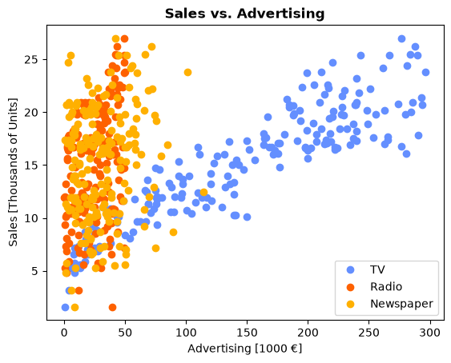
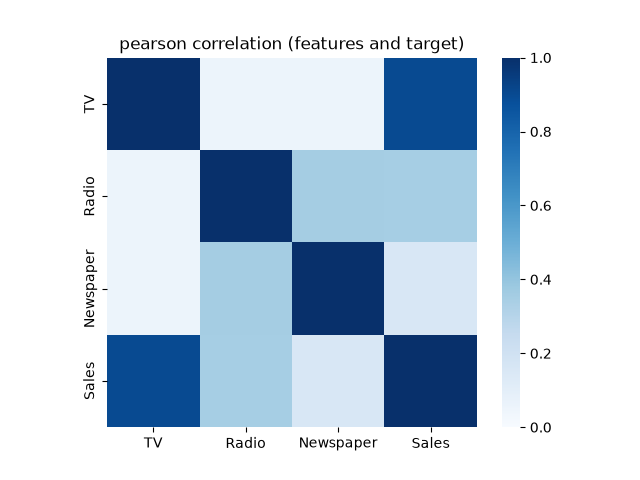

# Advertising Spend vs. Sales: Multiple Linear Regression

Predicting product sales from advertising spend on TV, Radio and Newspaper. Features are chosen by forward selection with 5-fold cross-validation, and the analysis tests whether interaction terms between channels improve the model.

## Overview

The dataset has 200 markets. For each market it records the advertising budget for three channels and the resulting sales:

| Column      | Description                          | Units                   |
|-------------|--------------------------------------|-------------------------|
| `TV`        | TV advertising spend                 | thousands of €          |
| `Radio`     | Radio advertising spend              | thousands of €          |
| `Newspaper` | Newspaper advertising spend          | thousands of €          |
| `Sales`     | Product sales (target)               | thousands of units sold |

The data is clean: there are no missing values, all columns are numeric and there are no obvious outliers.

The questions addressed are:
1. Which advertising channels actually help predict sales?
2. Does spending on one channel change how effective another channel is (an interaction effect)?

## Method

1. **Exploratory analysis.** A scatterplot of sales against spend for each channel, followed by Pearson, Kendall and Spearman correlation heatmaps of all variables.
2. **Model.** Ordinary least squares regression using scikit-learn's `LinearRegression`.
3. **Forward feature selection.** A custom greedy algorithm adds one feature at a time, each time choosing the feature that most improves the mean cross-validated MSE over 5 folds. R² is recorded alongside it.
4. **Interaction terms.** Pairwise products (`TV:Radio`, `TV:Newspaper`, `Radio:Newspaper`) are added. All features are then min-max scaled to [0, 1] and forward selection is repeated over the six candidates.

## Key Findings

<p align="center">
  
  
</p>

**Correlation.** TV spend is strongly correlated with sales (Pearson r ≈ 0.90). Radio shows a weak to moderate correlation (r ≈ 0.35). Newspaper shows almost none (r ≈ 0.16). All three correlation measures agree on this.

**Feature selection (mean 5-fold cross-validated scores):**

| Features                    | Test MSE | Test R² |
|-----------------------------|---------:|--------:|
| TV                          | 5.35     | 0.804   |
| TV + Radio                  | 2.85     | 0.896   |
| TV + Radio + Newspaper      | 2.86     | 0.895   |
| **TV + TV:Radio**           | **2.61** | **0.903** |

- **Newspaper adds nothing.** Including it makes the cross-validated error slightly worse, so it is dropped.
- **The TV × Radio interaction matters.** The model `TV + TV:Radio` beats `TV + Radio` and was the second feature forward selection picked. This means the two channels work together: the return on TV advertising is higher in markets that also spend on radio.
- Adding further terms produced little or no improvement. Adding the Radio main effect lowered the mean MSE only slightly (2.61 → 2.56), which is well within the variation between folds. Every other term made the error worse.

**Selected model:** `Sales ~ TV + TV:Radio`

**Business takeaway:** TV is the main driver of sales, and its effect is amplified when it runs alongside radio. Newspaper spend shows no measurable return in this data.

## Repository Structure

```
├── Advertising_-_Linear_Regression.ipynb   # Full analysis
├── data/
│   └── Advertising.csv                      # Raw dataset (200 rows)
└── res/                                     # Figures generated by the notebook
    ├── data.png                             # Sales vs. advertising spend scatterplot
    ├── pearsonCorrHeatmap.png
    ├── kendallCorrHeatmap.png
    └── spearmanCorrHeatmap.png
```

## Tools

Python, pandas, NumPy, scikit-learn, Matplotlib, seaborn and Jupyter Notebook.

## How to Run

```bash
git clone <repo-url>
cd <repo-folder>
pip install numpy pandas matplotlib seaborn scikit-learn jupyter
jupyter notebook Advertising_-_Linear_Regression.ipynb
```

Run all cells. The figures are written to `res/`, and the folder is created if it doesn't exist.
